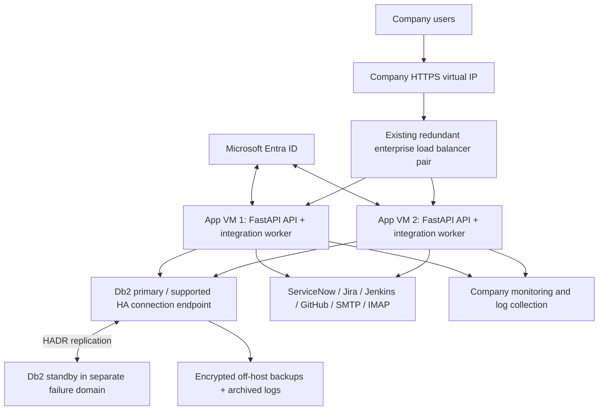

# On-premises infrastructure design

## Agreed constraints

Python/FastAPI; IBM Db2; Microsoft Entra ID; company SMTP/IMAP; ServiceNow change requests/change tasks; Jira, Jenkins and GitHub; environment sequence DEV → INT → QAT → PROD. Kubernetes is excluded. No container platform is required.

The supplied server templates assume company-managed **Linux VMs with systemd**, Python 3.12 and **Db2 LUW**. The server operating system and Db2 edition/version have not been supplied. If the database is Db2 for z/OS or IBM i, the driver, licensing, SQL and HA design must be reviewed for that platform. If application servers are Windows, use company-approved Windows service management instead of the included Linux units.

## Recommended topology

Place application VMs on different physical hosts/failure domains. A pair of VMs on one failed hypervisor does not provide host-failure protection. Use an existing highly available Db2 service and load-balancer service where available; only two new application VMs are then required. If those shared services do not exist, their redundant nodes and failover control must be provisioned by the infrastructure/DBA teams too.

One application server can run the app and restart failed processes, but it cannot meet a host-failure HA requirement. For a phased rollout, a single VM is suitable for development and integration testing, followed by the two-server topology for production.

## Application tier

Run one Uvicorn API service and one separate worker service per application server. The API serves the UI and short requests; workers perform source synchronization, task exports and email handling. Native service managers restart failed processes. A worker outage does not prevent users from reading already-synchronized release records.

All durable work lives in Db2. API instances share browser sessions and OAuth state through the database, so a sign-in callback can land on either server. No sticky sessions are required. Row updates serialize release transitions. Compare-and-set claims keep two workers from taking the same queued operation at the same time.

Start with **4 vCPU, 8 GB RAM and 40–60 GB OS/log space per application VM**, assuming an internal team with tens of concurrent users and hundreds of activities per release. This is a sizing assumption, not a benchmark result. Measure under representative data before fixing capacity. One process has a pool of five Db2 connections with two overflow connections; two APIs plus two workers can therefore open up to 28 connections, plus DBA/maintenance connections. Reserve database capacity accordingly and tune it with the DBA.

Rolling updates drain one API backend, stop its worker, deploy the version, verify database readiness, start services, then restore traffic. Repeat on the other server. Schema changes must be compatible with both versions during a rollout; breaking changes need a planned maintenance window or an expand/migrate/contract sequence.

## Database availability

For Db2 LUW, use a DBA-managed HADR primary/standby configuration with supported cluster management, quorum and fencing. HADR replication alone does not elect a safe primary or prevent split brain. Do not put a blind round-robin TCP load balancer in front of a primary and read-only standby.

Use the company's supported writable database endpoint and configure IBM automatic client reroute or another DBA-supported failover mechanism. A connection reroute does not guarantee continuation of an in-flight transaction. The app must roll it back, return a failure and reconnect; external writes with uncertain outcomes require reconciliation. SQLAlchemy's connection pre-ping replaces dead pooled connections at checkout but cannot restore a lost transaction.

The DBA chooses HADR synchronization mode based on latency and data-loss requirements. A synchronous same-site design can target zero committed-transaction loss for supported single-node failure scenarios; cross-site disaster recovery needs a separately defined recovery point and monitoring of replication/log-shipping lag. Backups remain necessary because replication also carries accidental or malicious changes.

Provision encrypted data/log storage, automated backups, log archival and off-host immutable copies according to company policy. Establish restore tests, retention and transaction-log sizing with the DBA. The starter schema uses VARCHAR keys and CLOB payloads; validate UTF-8 code page, page size/index limits and query plans on your exact Db2 version before executing the provided DDL.

## Load balancing and network

Use a redundant existing company load balancer with a stable HTTPS DNS name and corporate certificates. The reference HAProxy file describes health-based routing; it does not create the redundant load balancers or their failover VIP. Backend HTTPS certificates are also verified. Restrict API port 8000 to load balancers and monitoring sources. Database and mail traffic use TLS.

Required flows are: users to VIP 443; load balancers to application 8000; applications to Db2's actual TLS listener (commonly 50001, confirm locally); applications to source APIs over 443; SMTP STARTTLS 587; IMAP TLS 993; and applications to Entra authorization/token/JWKS endpoints over 443. Company DNS, NTP, certificate/CRL and monitoring access must also be available. Adapt ports to the real services.

Keep `/metrics` and `/health/*` private at the load balancer/firewall. Use `/health/ready` to determine if an API can reach its schema. A database outage should remove the API from user traffic, but it should not cause repeated process restarts; `/health/live` is independent of the database.

## Identity and access

Register a single-tenant Entra web application with the exact HTTPS callback `/auth/callback`. The backend implements authorization code flow with PKCE, state and nonce verification. It validates signed tokens with tenant-specific issuer, audience and expiry checks. User roles are `Release.Reader`, `Release.Operator` and `Release.Admin`.

Readers can inspect releases. Operators can add notes, prepare plans, queue sends/exports and review stakeholder replies. Administrators can also reconcile uncertain email delivery. Restrict enterprise-app assignments and apply company MFA/conditional-access policies. The app stores opaque browser sessions in Db2; session cookies are secure, HttpOnly and SameSite=Lax. It checks the request origin on cookie-authenticated writes. The UI and API share an origin.

CI deployment evidence uses a separate rotating webhook secret. In this starter it is a trusted service integration, not a per-build digital signature. Restrict its endpoint to Jenkins egress, store the token in Jenkins credentials, rotate it, and verify manifests are generated by controlled pipelines. For a stricter enterprise control model, replace the shared secret with Entra workload authentication or mTLS.

Secrets should be injected from the approved company secret manager. Protected server environment files are a minimum deployment mechanism, not a replacement for secret lifecycle management. Do not store secrets in tickets, execution notes, manifests, source control or logs.

## Reliability semantics

- Read-only source syncs retry up to three attempts with backoff and leave visible failure records. A failed dependency does not erase the last successful local snapshot.
- Preparation is idempotent for a release/environment transition and captures a handover snapshot. It does not execute database scripts or trigger deployment.
- SMTP has no exactly-once guarantee. After a delivery timeout or worker interruption, the app records an uncertain outcome and does not resend automatically. An administrator checks the company mailbox/mail trace and records the outcome before any resend.
- ServiceNow creation uses a stable correlation marker. A failed response can mean the ticket was created. Reconciliation searches that marker rather than repeating the POST.
- IMAP uses UIDVALIDITY and UID tracking, without changing read/unread flags. Replies are deduplicated and must match a tracking reference or message thread plus the expected sender. Sender matching is not proof of cryptographic sender authenticity; company mail controls and operator review remain necessary.
- Deployment evidence identifies the exact environment, repository, revision, Jenkins build and issue list. Jira status, a merged commit or a successful build alone never marks a defect deployed.
- Promotions require target tasks, explicit stakeholder approvals and confirmed target deployment evidence covering every Jira issue in the release scope. Live completion also requires authoritative ServiceNow tickets, a created consolidated release task and activity status refreshed within `SOURCE_MAX_AGE_SECONDS` (15 minutes by default). This starter does not model multi-repository mandatory-component policies, rollback/redeployment supersession or segregation of duties; add those domain rules before using it as a regulated production release gate.

## Operations targets to agree

Proposed starting targets: 99.9% monthly availability (about 44 minutes of monthly downtime), application-node recovery within a few minutes, and database recovery within 15 minutes. Disaster recovery RPO/RTO must be set with the DBA based on synchronization mode, backups and business needs. These are design objectives, not measured guarantees.

Monitor API error ratio/latency, both readiness endpoints, worker heartbeats, queue age/failures, uncertain external outcomes, source freshness, mail lag, Db2 replication lag, database connections/locks/storage, certificate expiry and backup success. The included Prometheus rules cover a subset; connect the remaining source/Db2 and synthetic checks to company monitoring.

## Production acceptance

Run the real-system checks in the operations runbook before production use. This package has not been deployed on company servers, authenticated against your Entra tenant, executed on live Db2, or certified for HA. ServiceNow mappings, Jira edition, network policy, operational ownership, retention and change-management controls still need company-specific validation.

## Primary references

- [IBM HADR documentation](https://www.ibm.com/docs/SSEPGG_11.1.0/com.ibm.db2.luw.admin.ha.doc/doc/c0011267.html) and [IBM client-reroute guidance](https://www.ibm.com/docs/en/db2/12.1.x?topic=reroute-configuring-automatic-client) inform the Db2 failover design; use the documentation matching your installed version.
- [IBM Python driver setup](https://www.ibm.com/docs/en/db2w-as-a-service?topic=framework-setting-up-python-environment) describes `ibm_db` and the optional SQLAlchemy adapter.
- [Microsoft Entra OIDC](https://learn.microsoft.com/en-us/entra/identity-platform/v2-protocols-oidc) describes the sign-in protocol.
- [SQLAlchemy pooling](https://docs.sqlalchemy.org/en/20/core/pooling.html) explains pre-ping behavior and its transaction limits.
- [HAProxy health checks](https://www.haproxy.com/documentation/haproxy-configuration-tutorials/reliability/health-checks/) describes the reference readiness checks.
